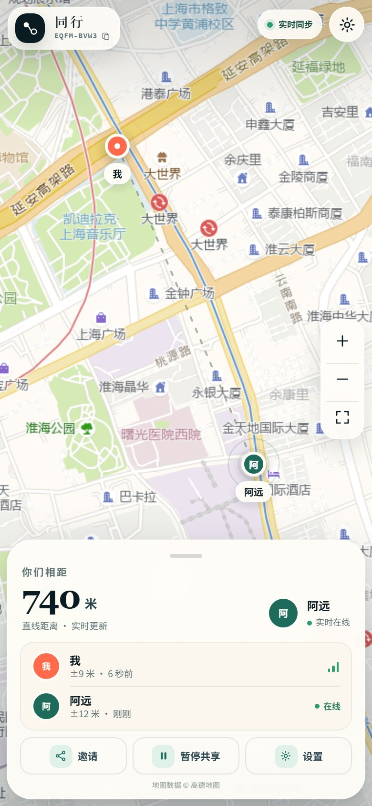
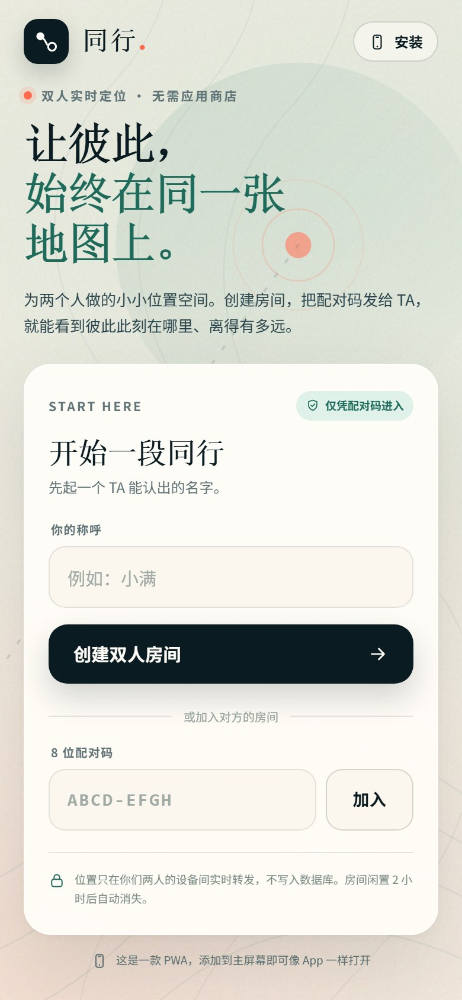
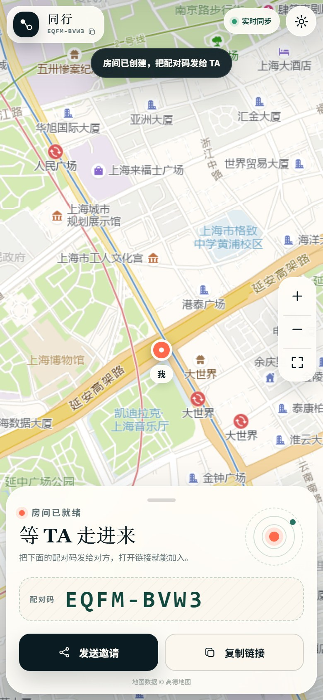
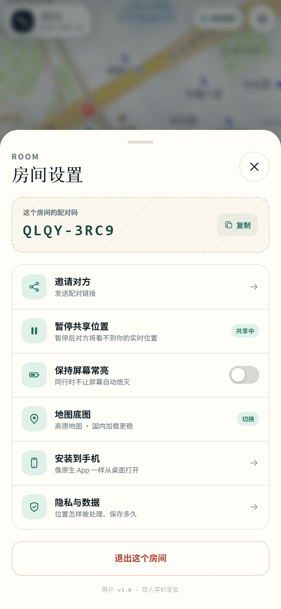
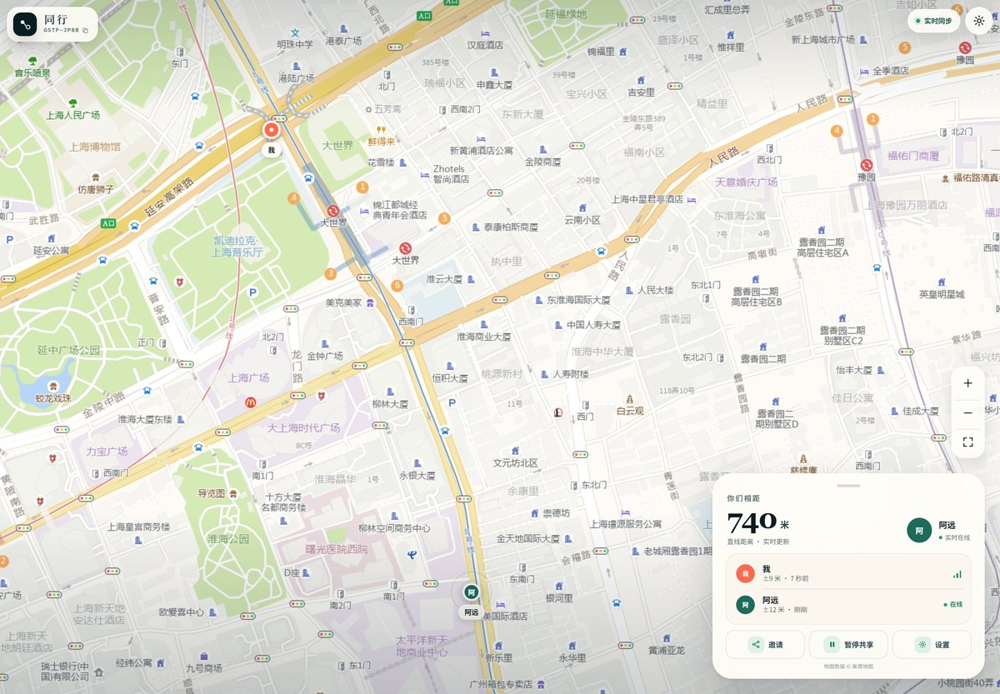

# 同行 · 两个人的实时地图

一款**为两个人设计的实时定位 PWA**。创建房间，把 8 位配对码发给 TA，就能在地图上看见彼此、距离和定位精度。

**iOS / Android 通用，不需要上架应用商店。** 用浏览器打开后「添加到主屏幕」，即可像 App 一样从桌面启动。



## 目录

- [它是什么](#它是什么)
- [核心功能](#核心功能)
- [5 分钟本地运行](#5-分钟本地运行)
- [部署到公网（推荐 Render）](#部署到公网推荐-render)
- [装到手机上](#装到手机上)
- [自己的服务器 / Docker](#自己的服务器--docker)
- [地图底图与坐标](#地图底图与坐标)
- [隐私与数据](#隐私与数据)
- [项目结构](#项目结构)
- [测试](#测试)
- [已知边界](#已知边界)
- [常见问题](#常见问题)

## 它是什么

「同行」是一个**两人制**的位置空间：

- 一个人创建房间，得到 8 位配对码和邀请链接。
- 另一个人打开链接、输入配对码加入。
- 双方允许定位后，位置通过 SSE 实时同步，显示在同一张地图上。

它使用 **PWA（渐进式 Web 应用）** 技术，因此一套代码同时适配 iPhone 和 Android，也不需要 Apple Developer 账号、Google Play 上架流程或安装包签名。

### 它不是

- 不是应用商店里的原生 App；不能像原生 App 那样在锁屏后持续后台上报位置。
- 不是历史轨迹/围栏/告警系统；当前只显示实时位置。
- 不是端到端加密通信；服务端在内存中短暂处理坐标（见[隐私](#隐私与数据)）。

如果你需要**真正后台持续定位、地理围栏、推送通知**，需要再做一层 Capacitor / React Native 原生壳，并承担 App Store / Play Store 的审核与签名成本。当前版本先把「两个人打开就能看见彼此」做到最简单。

## 核心功能

| | |
|---|---|
| 双人房间 | 8 位随机配对码，最多两人，第三人会被拒绝 |
| 实时同步 | SSE 长连接 + 2.5 秒轮询兜底，位置变化约 2～4 秒内送达，静止时也有心跳 |
| 地图展示 | 高德底图（国内加载稳定），可切换到 OpenStreetMap |
| 距离与精度 | 直线距离、双方定位精度、更新时间、在线/离线状态 |
| 隐私开关 | 一键暂停共享，服务端立即清除你的位置 |
| 移动端优先 | 全屏地图、底部状态卡、安全区适配、触控友好 |
| PWA | Manifest、Service Worker、主屏幕图标、离线应用外壳 |
| 零依赖 | 服务端只用 Node.js 内置模块，没有 npm 依赖 |
| 易部署 | Dockerfile、Render Blueprint、Caddy 示例 |

### 界面

| 创建 / 加入 | 等待对方 | 房间设置 |
| --- | --- | --- |
|  |  |  |

桌面端使用右侧悬浮状态卡：



## 5 分钟本地运行

### 环境

- Node.js **18 或更高版本**（推荐 20/22）
- 现代浏览器：iPhone Safari、Android Chrome、桌面 Chrome / Edge / Safari

### 启动

```bash
cd 项目目录
npm start
```

不需要 `npm install`，项目没有第三方运行时依赖。

Windows 用户也可以直接双击 **`start-windows.cmd`**：脚本会检查 Node.js，然后启动服务并打开浏览器。

打开：

```
http://localhost:8787
```

1. 输入昵称，点「创建双人房间」。
2. 复制邀请链接，在**另一台设备**或**无痕窗口/另一个浏览器**中打开。
3. 输入配对码加入；两端允许定位后，就能看到两个标记。

> 同一浏览器的普通标签页共享 `localStorage`，会被识别为同一个成员。想在一台电脑上测试两个人，请用无痕窗口，或使用 Chrome/Edge 的不同配置文件。

> **手机直接访问电脑局域网 IP（如 `http://192.168.1.8:8787`）时，浏览器不会授予定位权限。**
> 这是浏览器的安全限制：定位只允许在 HTTPS 或 localhost 下使用。手机真机测试请用下面的公网部署，或临时使用 HTTPS 隧道。

### 手机快速联调（临时 HTTPS）

```bash
# 任选其一
npx cloudflared tunnel --url http://localhost:8787
ngrok http 8787
```

把工具给出的 `https://...` 地址在手机上打开。临时隧道仅用于测试，不建议长期使用。

也可以使用 Cloudflare 的免账号 Quick Tunnel（重启后域名会变化）：

```bash
cloudflared tunnel --url http://127.0.0.1:8787 --no-autoupdate
```

> Quick Tunnel 没有可用性保证，适合临时给手机安装/体验；长期使用请走下面的 Render 或自己的服务器，并绑定固定域名。

## 部署到公网（推荐 Render）

项目包含 `render.yaml`，可以走 Render 的 Blueprint 一键部署。

1. 把项目推到一个 GitHub 仓库：

   ```bash
   git init
   git add .
   git commit -m "feat: 同行实时定位"
   git branch -M main
   git remote add origin https://github.com/<你的用户名>/<仓库名>.git
   git push -u origin main
   ```

2. 打开 [Render](https://render.com/) → **New** → **Blueprint** → 选择这个仓库。
3. Render 会读取 `render.yaml`，创建一个 Node Web Service，并自动分配 `https://<name>.onrender.com` 地址。
4. 打开地址，创建房间，把邀请链接发给对方。

也可以手动创建 **Web Service**：

- Runtime：Node
- Build Command：`npm install`
- Start Command：`npm start`
- Health Check Path：`/healthz`

### Render 免费版注意

- 免费实例约 15 分钟无访问会休眠，再次打开需要几十秒唤醒。
- **服务端内存中的房间会随实例重启/休眠而消失。** 对「临时约一下」够用；如果要长期稳定使用，请用付费常驻实例或自己的 VPS。
- 免费实例只有一个进程，房间状态不能跨实例共享。不要开多副本。

## 装到手机上

### iPhone / iPad（Safari）

1. 用 **Safari** 打开部署后的 `https://` 地址。
2. 点底部的「分享」按钮（方框向上箭头）。
3. 向下找到「添加到主屏幕」→「添加」。
4. 从桌面打开「同行」。

> 微信 / QQ 内置浏览器通常不能直接安装，请点右上角「…」→「在浏览器打开」，再用 Safari。

### Android（Chrome / Edge）

1. 用 Chrome 或 Edge 打开 `https://` 地址。
2. 点右上角「⋮」菜单。
3. 选择「安装应用」或「添加到主屏幕」。
4. 从桌面打开。

安装后以独立窗口运行，没有地址栏；首次打开仍需联网加载地图。

## 自己的服务器 / Docker

### Docker

```bash
docker build -t tongxing .
docker run -d --name tongxing -p 8787:8787 --restart unless-stopped tongxing
```

或使用 Compose：

```bash
docker compose up -d --build
```

### 配 HTTPS（Caddy）

定位必须 HTTPS。用 Caddy 反向代理最省事：

```bash
# 把 Caddyfile.example 复制为 Caddyfile，修改域名
sudo cp Caddyfile.example /etc/caddy/Caddyfile
sudo systemctl reload caddy
```

示例：

```caddyfile
tongxing.example.com {
	encode zstd gzip
	reverse_proxy 127.0.0.1:8787
}
```

Caddy 会自动申请 Let's Encrypt 证书。记得把域名的 DNS A/AAAA 记录指向服务器。

### Nginx 注意

SSE 需要关闭代理缓冲，否则位置更新会延迟：

```nginx
location / {
    proxy_pass http://127.0.0.1:8787;
    proxy_http_version 1.1;
    proxy_set_header Host $host;
    proxy_set_header X-Forwarded-Proto $scheme;
    proxy_buffering off;
    proxy_read_timeout 3600s;
}
```

服务端已经返回 `X-Accel-Buffering: no`，但不同代理仍建议显式关闭。

### 环境变量

| 变量 | 默认 | 说明 |
| --- | --- | --- |
| `PORT` | `8787` | 监听端口 |
| `HOST` | `0.0.0.0` | 监听地址 |

## 地图底图与坐标

默认使用**高德地图**栅格底图，国内网络更容易加载。高德使用 **GCJ-02** 坐标系，而浏览器 GPS 返回 **WGS-84**；应用在绘制标记前会做坐标转换，距离仍用原始 WGS-84 计算。

可以在「房间设置 → 地图底图」切换，或在链接后加参数：

```
https://你的域名/?room=ABCDEFGH&map=osm
```

`map=osm` 使用 OpenStreetMap 标准瓦片。海外访问更合适；国内部分地区可能加载慢或不可达。

> 当前高德底图使用公开栅格瓦片端点，**未配置商业 API Key**。用于个人/小范围演示没问题；如果要公开运营或商用，请按高德开放平台的要求申请 Key、遵守其服务条款，或替换为你有授权的地图服务。OpenStreetMap 瓦片也有自己的[使用政策](https://operations.osmfoundation.org/policies/tiles/)，不要高并发抓取。
>
> 地图底图服务会收到你的 IP 和瓦片请求，这是地图加载的必要网络行为。

## 隐私与数据

- **只允许两人**：房间码是 8 位、约 40 bit 随机值；每个成员另有服务端生成的随机 token，更新位置时必须携带。
- **不写数据库**：位置只存在 Node 进程内存里；暂停共享或退出房间会清除该成员的位置。
- **自动过期**：无连接且闲置 2 小时后，房间从内存删除；进程重启也会清空所有房间。
- **不记录位置日志**：服务端打印启动信息，不打印坐标。
- **不是端到端加密**：服务端在内存中可以读到坐标以完成转发。请使用可信的 HTTPS 部署。
- **前台定位**：手机锁屏或切后台后，系统可能暂停定位；回到页面会自动恢复。
- **对外请求**：只请求地图瓦片（高德/OSM）。不读取通讯录、相册、麦克风、摄像头。

上线前建议在页面或应用说明中告知使用者以上内容。

## 项目结构

```text
.
├── server.js                 # 零依赖 Node 服务端：静态资源 + 房间 API + SSE
├── public/
│   ├── index.html            # 单页界面
│   ├── styles.css            # 移动端优先样式
│   ├── app.js                # 房间状态、SSE、地图、定位
│   ├── manifest.webmanifest  # PWA 清单
│   ├── sw.js                 # Service Worker（只缓存应用外壳）
│   ├── icons/                # 图标和社交分享图
│   └── vendor/leaflet.*      # 本地 Leaflet 运行时（BSD-2-Clause）
├── tests/server.test.mjs     # Node 内置测试
├── scripts/
│   ├── make_icons.py         # 重新生成图标
│   ├── capture.mjs           # CDP 截图辅助
│   └── scene.mjs             # 模拟双人房间截图
├── Dockerfile
├── compose.yaml
├── render.yaml
├── Caddyfile.example
├── start-windows.cmd
└── package.json
```

### 服务端接口

| 方法 | 路径 | 说明 |
| --- | --- | --- |
| `POST` | `/api/rooms` | 创建房间 |
| `POST` | `/api/rooms/:code/join` | 加入 / 用 token 重连 |
| `GET` | `/api/rooms/:code/events` | SSE 房间快照流 |
| `GET` | `/api/rooms/:code/state` | 轮询兜底快照（Bearer token） |
| `POST` | `/api/rooms/:code/location` | 上报位置（Bearer token） |
| `POST` | `/api/rooms/:code/sharing` | 暂停 / 恢复共享 |
| `POST` | `/api/rooms/:code/leave` | 退出并释放名额 |
| `GET` | `/healthz` | 健康检查 |

## 测试

```bash
npm test
```

覆盖：静态资源与安全头、路径穿越、房间创建/加入/满员、token 重连、SSE 快照、位置同步、暂停共享、退出、参数校验。

如果 `node --test` 在当前 Windows 沙箱里因为子进程限制失败，直接用：

```bash
node tests/server.test.mjs
```

## 已知边界

- **只支持两人**。第三人加入返回 409；如果原成员清除了浏览器数据，建议重新创建房间。
- **无历史轨迹**：刷新/重启不保留轨迹；房间闲置 2 小时后消失。
- **无后台定位**：PWA 无法保证锁屏后继续上报。这是 iOS/Android 对 Web 应用的限制。
- **无账号体系**：配对码就是入场凭证，不要公开发布。
- **单实例内存**：多副本部署时房间不共享；需要横向扩展可把房间状态迁到 Redis，并改用 Redis Pub/Sub 广播。
- **地图授权**：正式商用请替换为有授权的地图服务。

## 常见问题

**打开后地图是灰的？**
检查是否能访问地图服务。国内优先用高德（默认）；海外可在设置里切换 OpenStreetMap，或加 `?map=osm`。

**定位权限弹不出来 / 一直“等待定位信号”？**
必须使用 `https://`（或 `localhost`）。检查系统定位服务、浏览器站点权限；微信内置浏览器请改用 Safari/Chrome。

**手机和电脑能打开同一个页面，但看不到对方？**
确认双方输入的是同一个 8 位配对码、房间没满；如果一端显示“实时同步”，另一端也应在线。服务端重启后旧房间会失效，需要重新创建。

**能改成多人吗？**
可以。服务端把 `ROOM_CAPACITY` 调大，并调整前端 `getPartner()` 为成员列表渲染即可；但「两人」是当前产品定位，界面也是按双人设计的。

**想上架 App Store / Google Play？**
当前是 PWA，不需要上架。若必须上架并需要后台定位，可用 Capacitor 包一层原生壳，补充后台定位权限说明和隐私政策，再走应用商店流程。

## License

MIT。Leaflet 使用 BSD-2-Clause，见 `public/vendor/LEAFLET-LICENSE.txt`。地图数据版权归各自提供方所有。
